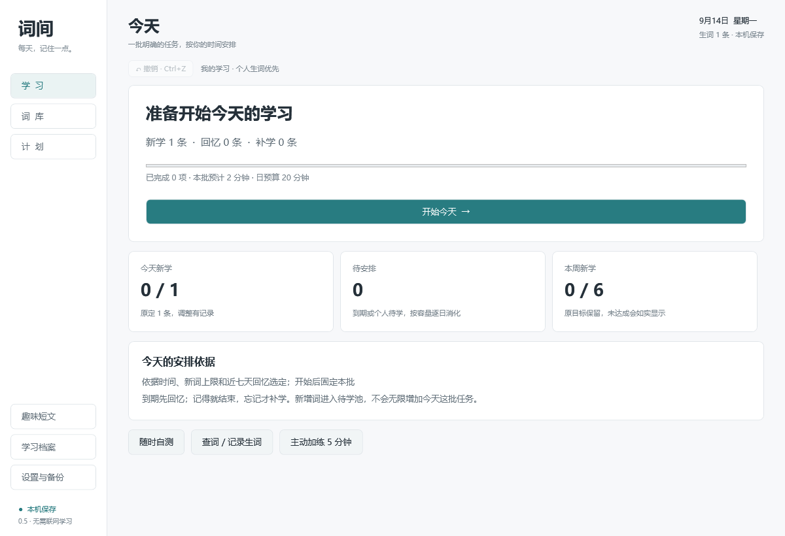

# 词间 · Cijian

每天，记住一点。

词间是面向高中英语学习的 Windows 离线背词工具。它把新词学习、到期回忆和遗忘后的补学放进同一个每日流程，并按可用时间安排任务。当前版本为 **0.5.0 · 每日学习版**，使用 C#、WPF 与 .NET 8 开发。



## 下载和开始使用

1. 打开本仓库的 [Releases 下载页](../../releases/latest)，下载 `cijian-0.5.0-win-x64.zip`。
2. 将整个压缩包解压到有写入权限的文件夹，例如“文档/词间”。
3. 在 Windows 10/11 上安装 [.NET 8 Desktop Runtime](https://dotnet.microsoft.com/en-us/download/dotnet/8.0)（Windows x64；选择 Desktop Runtime）。
4. 双击 `高中单词计划.exe`，点击“开始今天”。

程序当前保留早期的 EXE 文件名。请保留解压后的全部文件和 `Assets` 文件夹，不要只复制 EXE，也不要在压缩包里直接运行。GitHub 的 **Code → Download ZIP** 是源码下载，普通使用者请选择 **Releases** 中的程序包。

完整操作说明见 [使用说明](docs/使用说明.md)。

## 主要功能

- **统一的每日学习**：新词先看讲解，到期词先回忆；识义与拼写分别记录。
- **有容量的计划**：新学、回忆与补学共同占用时间预算；开始后保持当天任务稳定，未完成内容明确延期。
- **个人生词导入**：TXT 一行一个词或短语；导入前预览匹配和重复，支持撤销。零散积累与完整排查有不同含义。
- **离线查词**：随程序包提供 770,611 条词典记录；查词后可以主动加入学习。
- **独立学习档案**：多人的进度、笔记、短文和备份分别保存。
- **本机数据管理**：自动保存、上一份备份、JSON 导出与恢复。
- **可选趣味短文**：复制提示词到自己的 ChatGPT，再粘贴结果保存；软件不直接调用模型 API。

学习与查词可离线使用。程序没有账号、云同步或付费 API；使用外部 ChatGPT 生成短文时，需要自行联网。

## 词库范围与边界

| 内容 | 当前数量 | 含义 |
|---|---:|---|
| 2020 修订版课标核心 | 3000 个条目 | 明确版本的范围，不代表每人都需要重学 |
| 精选拓展起步包 | 16 条 | 已筛选的可选学习候选 |
| 降级拓展参考 | 34 条 | 供查阅或自行加入 |
| 其余旧参考资料 | 797 条 | 保留稳定身份与已有进度 |
| 离线词典 | 770,611 条 | 查词支持，不等于必背清单 |

合并学习目录为 3847 条。300–400 个重点课外词与约 1200 个拓展条目仍属于后续审核目标，当前没有完成这两套词书。核心范围完整不代表所有义项、搭配和例句均经人工审校，也不代表某届考试的具体实施范围。

详见 [词库审核报告](docs/词库审核报告.md) 与 [学习安排依据](docs/学习安排依据.md)。本项目是个人学习工具，学习参数仍需实际使用校准；测试通过不代表已证明长期记忆或考试成绩提升。

## 数据保存和备份

默认档案保存在程序旁的 `Data/`；其他档案在 `Profiles/<档案标识>/Data/`，档案目录为 `profiles.json`。建议在“设置与备份”中定期导出 JSON。迁移所有档案时，可复制整个程序文件夹。

源码仓库和发布 ZIP 均排除个人学习记录、档案及自动备份。公开提交问题时，也请先删去导出文件中的个人内容。

## 从源码构建

需要 **Windows 10/11、.NET 8 SDK**。应用没有外部 NuGet 包依赖；`NuGet.Config` 清空包源，使用 SDK 自带的框架引用。需要安装 Windows 桌面目标包，建议在 Windows 上构建。

```powershell
git clone https://github.com/sanctuary11240410-alt/cijian.git
cd cijian
dotnet build src/WordCoach.App/WordCoach.App.csproj -c Release
dotnet run --project src/WordCoach.App/WordCoach.App.csproj -c Release
```

较大的 `dictionary.db` 不进入 Git 历史。构建前如需完整离线查词，请从发布程序包中复制 `Assets/dictionary.db` 到 `src/WordCoach.App/Assets/dictionary.db`。未复制时可构建，词典功能会显示缺失。

也可用 Python 3.11+ 从 [ECDICT](https://github.com/skywind3000/ECDICT) 的 `ecdict.csv` 生成：

```powershell
python tools/build_dictionary.py path/to/ecdict.csv src/WordCoach.App/Assets/dictionary.db
```

生成发布文件夹：

```powershell
dotnet publish src/WordCoach.App/WordCoach.App.csproj -c Release -r win-x64 --self-contained false -o artifacts/publish
```

分发时还应附上 `docs/` 中的说明和 `licenses/` 中的第三方许可。内容生成脚本及原始资料要求见 [开发说明](docs/开发说明.md)。

## 验证

这些测试项目是独立的控制台检查程序，使用 `dotnet run` 执行：

```powershell
dotnet run --project tests/LogicChecks -c Release
dotnet run --project tests/CorpusChecks -c Release
dotnet run --project tests/ImportChecks -c Release
dotnet run --project tests/DictionaryChecks -c Release
dotnet run --project tests/ProfileImportChecks -c Release -- artifacts/profile-import
dotnet run --project tests/ProfileUiChecks -c Release -- artifacts/profile-ui
dotnet run --project tests/UiV05 -c Release -- artifacts/ui-v05
```

词典检查与完整 UI 检查需要上面的离线词典。UI 检查需要 Windows 桌面环境，生成的数据仅用于测试。0.5 开发时的 176 项验收结果见 [历史验收记录](docs/历史验收记录.md)，本次上传复验见 [发布说明](docs/发布说明-0.5.0.md)。

## 项目结构

```text
src/WordCoach.Core/   学习状态、调度与导入规则
src/WordCoach.App/    Windows WPF 界面、档案与词典服务
tests/               逻辑、词库、导入、档案与界面检查
tools/               词库生成和证据审核脚本
docs/                使用、内容审核、开发与 GitHub 更新说明
licenses/            随附的第三方许可证
```

## 来源、许可与反馈

ECDICT 采用 MIT 许可证；HK-SHAO/English-Dictionary 的相关旧词库资料采用 Apache-2.0。具体说明见 [第三方来源](THIRD_PARTY_NOTICES.md)。这些许可证仅适用于相应第三方内容；当前未为本项目原创代码指定开源许可证，公开可见不表示自动授予再分发或商业使用许可。

由仓库所有者维护。使用问题与建议可在本仓库 **Issues** 中提交，请写明 Windows 版本、词间版本、操作步骤和错误提示。如何下载、更新代码及发布新版，见 [GitHub 使用与更新指南](docs/GitHub使用与更新指南.md)。
